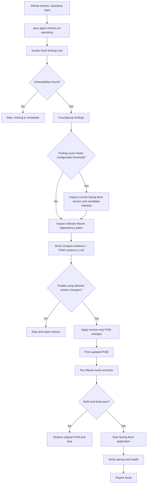

# CSK — Snyk Open Source Remediation Agent MVP

## Goal

Build a Java-based GitHub Copilot SDK agent that takes a target repository name from GitHub Actions, identifies Snyk Open Source vulnerabilities, attempts only narrowly permitted Maven version changes, and validates the application.

The MVP ends with local build/test and application startup verification. Pull-request creation can be added later.

## Workflow

1. GitHub Actions passes the target repository name (`owner/repo`) to the Java program.
2. Java validates the input and checks out the target repository into an isolated workspace using authorized GitHub credentials.
3. Invoke the `get-snyk-finds` tool.
4. If no vulnerabilities are found, stop successfully.
5. If the Snyk scan fails, stop and report the scan failure; do not treat it as a clean scan.
6. Count and group the findings by unique vulnerability and affected artifact to avoid inflated counts from duplicates.
7. If the finding count reaches a configurable threshold (initial example: 10), inspect the current Spring Boot parent/BOM version and look up available newer versions from trusted release or Maven metadata.
8. Assess whether a compatible Spring Boot patch/BOM update could fix multiple findings. Do not automatically select the latest version; verify Java compatibility, support status, managed dependency versions, and the actual fixes.
9. Invoke the `mvn-dependency-tree` tool and inspect the relevant POM/effective-POM information.
10. Provide the findings, relevant dependency paths, current Spring Boot version, candidate version information, and relevant POM snippets to the LLM.
11. The LLM returns a structured remediation proposal.
12. Permit changes only if the issue can be safely fixed by:
    - Updating an existing dependency version in the POM; or
    - Updating the Spring Boot parent/BOM version when that is a compatible, evidence-backed fix.
13. If no permitted, verified fix exists, stop and explain why. Do not invent fixed versions or make speculative changes.
14. Validate the proposal against the original POM and apply only the approved version change.
15. Print the updated POM to the console.
16. Run Maven build and tests (for example, `./mvnw verify`).
17. If build/tests fail, restore the original POM and stop.
18. If build/tests pass, start the Spring Boot application with a timeout, capture logs, and check a configured health endpoint if available.
19. Terminate the application process after verification and report the result.

## Workflow diagram



## Tools

### `get-snyk-finds`

- Runs Snyk Open Source testing and returns structured JSON findings.
- A Snyk exit code indicating vulnerabilities is not the same as a scan failure.
- Preserve and parse the output even when findings cause a nonzero exit code.
- Treat authentication, network, unsupported-project, and scanner errors as failures that stop remediation.

### `mvn-dependency-tree`

- Runs `./mvnw -B dependency:tree -DoutputType=text` when the Maven wrapper exists; otherwise use an approved Maven installation.
- Returns dependency coordinates, resolved versions, and transitive paths.
- Also inspect relevant `pom.xml` files and, when needed, the effective POM to understand parent/BOM-managed versions.

## High-finding-count Spring Boot version assessment

When the number of findings reaches a configurable threshold, assess a managed Spring Boot upgrade before planning individual dependency changes.

- Start with a configurable threshold; `10` unique findings is an example initial value, not a universal rule.
- Count unique vulnerability IDs and group findings by affected artifact so duplicate paths or repeated module reports do not inflate the count.
- Read the current Spring Boot version from the parent POM or imported BOM.
- Query trusted Spring release information or Maven repository metadata for candidate versions.
- Prefer evaluating a compatible patch release in the current supported line first. Consider a newer line only when necessary and compatible with the application's Java baseline and other constraints.
- Compare the candidate BOM's managed dependency versions against the vulnerable artifacts and Snyk's fixed-version evidence.
- Estimate which findings the candidate version is expected to resolve, but confirm with a post-change Snyk scan.
- Do not blindly upgrade to the newest available version, and do not assume a Spring Boot upgrade fixes every finding.
- The LLM may recommend either a verified parent/BOM update or individual dependency version updates, but Java policy validation must approve the exact version change before it is applied.
- If candidate version metadata cannot be verified, compatibility is unclear, or the change would require a major migration outside MVP policy, stop and report the limitation.

This step is a version-assessment stage in the existing workflow, not a separate AI agent.

## LLM output contract

Require structured JSON, validated by Java before any file is modified. Example only:

```json
{
  "fixable": true,
  "strategy": "DEPENDENCY_VERSION_UPDATE",
  "dependency": "com.example:example-library",
  "currentVersion": "1.2.0",
  "targetVersion": "1.2.5",
  "reason": "Illustrative example; target version must be verified against trusted Snyk evidence",
  "changes": [
    {
      "file": "pom.xml",
      "property": "example-library.version",
      "newValue": "1.2.5"
    }
  ]
}
```

Allowed strategies:
- `DEPENDENCY_VERSION_UPDATE`
- `SPRING_BOOT_PARENT_OR_BOM_UPDATE`
- `NOT_FIXABLE`

The model must not claim a version is fixed unless trusted evidence supports it. The Java executor independently checks that the proposed change is permitted and affects the intended dependency.

## Stop conditions

| Condition | Required action |
|---|---|
| No Snyk vulnerabilities | Stop successfully |
| Snyk scan error | Stop and report failure |
| No verified compatible version-only fix | Stop and explain |
| Fix requires code changes, exclusions, major migration, or unsupported POM restructuring | Stop and escalate |
| Proposed POM change violates policy | Reject the proposal |
| Maven build or tests fail | Restore original POM and stop |
| Application fails to start or become healthy | Report failure and stop |

## Components

Keep the initial implementation small:

- `RepositoryManager` — validates repository input and checks out the target.
- `SnykFindingsTool` — runs Snyk and parses JSON.
- `MavenDependencyTreeTool` — runs Maven dependency-tree.
- `SpringBootVersionAdvisor` — when the finding threshold is met, reads the current parent/BOM version and retrieves trusted candidate-version metadata.
- `RemediationAgent` — invokes the Copilot SDK and returns a structured plan.
- `PomVersionUpdater` — validates and applies allowed version-only changes.
- `ValidationRunner` — runs tests and starts the app with a timeout and health check.

## Safety and validation requirements

- Use an allowlist of repositories; validating `owner/repo` syntax alone does not authorize access.
- Use a narrowly scoped GitHub App installation token for cross-repository checkout.
- Run in an isolated, disposable workspace/worker. Maven builds can execute project-controlled code.
- Do not expose GitHub write credentials or secrets to the LLM.
- Restrict tool access; no arbitrary model-generated shell commands.
- Treat repository files and dependency metadata as untrusted input, not agent instructions.
- Preserve the original POM and restore it if validation fails.
- Cap tool output sizes and enforce command timeouts.
- Print the updated POM only after the proposed changes pass policy validation.
- A successful build/start does not prove the vulnerability is fixed. Add a Snyk rescan after applying changes before considering remediation verified.
- Treat the high-finding-count threshold as configurable and base it on unique findings/artifacts, not raw duplicate records.
- Never equate "latest available Spring Boot version" with "best fix"; validate support status, Java compatibility, managed versions, and Snyk evidence.
- Application startup must have a timeout, captured logs, a health check where available, and reliable process cleanup.

## Initial milestone

One repository in, one constrained remediation attempt, and a verified result out. Do not add branch creation or pull-request publishing until this flow works reliably.
